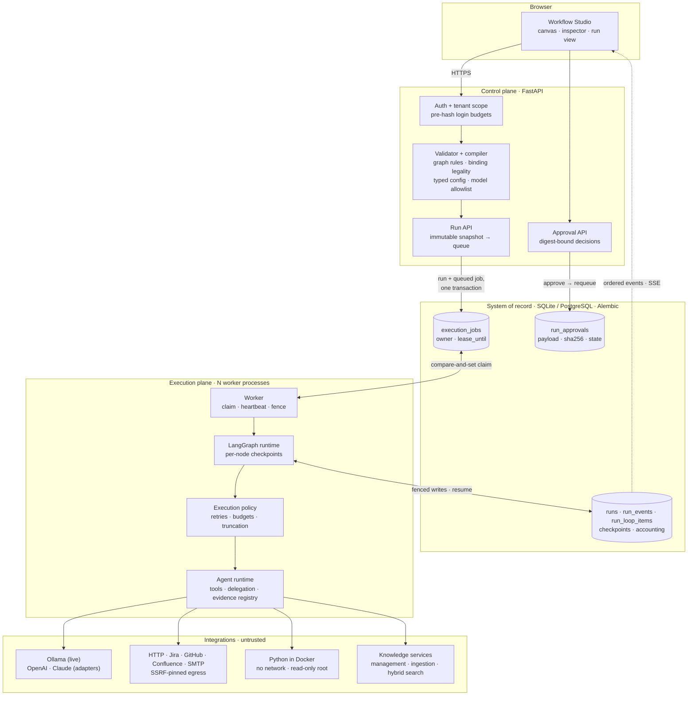
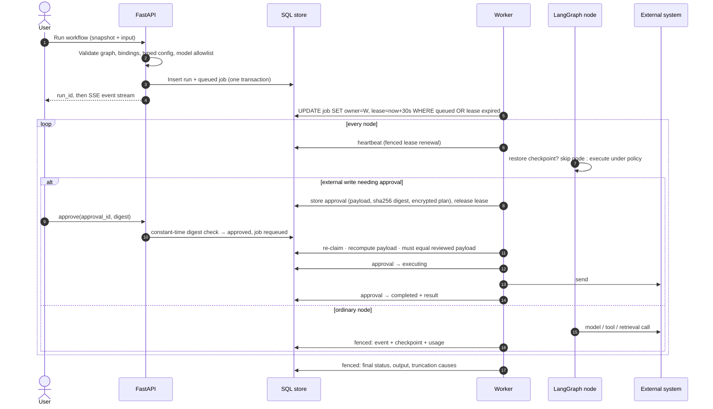
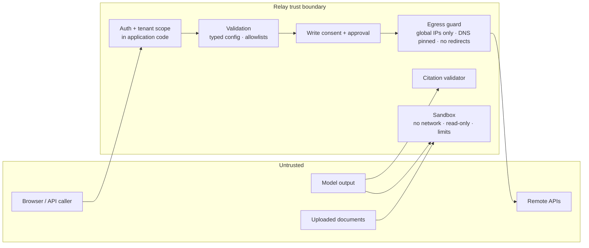

# Relay

**A local-first platform for building and running AI-agent workflows that survive crashes, do not send an external write a second time on their own, and refuse to guess.**

When the outcome of a write is unknown (the connection dropped after the remote system may have accepted it), the run stops and a person checks the remote system. Relay sends no idempotency key and has no reconcile step yet, so it prevents its own second send; it cannot make the remote system idempotent ([design §3](docs/design.md#3-did-the-external-write-happen)).

You draw a workflow on a canvas: a chat input, retrieval over your documents, agents with tools and specialist sub-agents, conditions, loops, approvals and a response. Relay compiles it to a LangGraph state machine and runs it on durable workers. The interesting part is not the canvas. It is what happens when things go wrong: a worker dies mid-loop, two workers think they own the same run, a Jira write times out after the server accepted it, a loop's results outgrow the database row, or a model invents a citation.

| | |
| --- | --- |
| **Status** | Working local platform, single workspace per account. Intended for loopback use until the deployment and identity work in §6 lands. Open defects: §7. |
| **Stack, run live** | React + React Flow · FastAPI · LangGraph · SQLAlchemy on SQLite or PostgreSQL · Alembic · Ollama · FAISS · Docker sandbox |
| **Stack, adapter, tested with fixtures** | OpenAI, Claude (recorded response shapes) · Elasticsearch, Pinecone (fake clients) · Jira, GitHub, Confluence, SMTP (local fixture receivers). None of these has run against the live service. |
| **Verification** | 2,204 backend tests run under five hash seeds · 128 frontend unit tests + 68 Chromium tests · 34 deployed-process production scenarios · PostgreSQL conformance · five GitHub Actions jobs · a 53-question grounding gate on a calibration set (§4) |

**Four measured numbers**

| What | Value | Where it comes from |
| --- | --- | --- |
| Backend tests | 2,204 backend tests collected; at `PYTHONHASHSEED` 0–4 each run gives 2,194 passed, 3 skipped (they need PostgreSQL), 7 xfailed (the open defects of §7) | `pytest --collect-only`; CI checks this number with [`scripts/check_readme_claims.py`](scripts/check_readme_claims.py) |
| Deployed-process scenarios | 34 deployed scenarios (S01–S29 with variants); on 2026-11-27 the gate passed 40 of 40 rows (34 scenarios, M01 and 5 stages), with no source file changed during the run | [`scripts/check_production_scenarios.py`](scripts/check_production_scenarios.py), [`evals/results/w03-2026-11-27/`](evals/results/w03-2026-11-27/) |
| A worker killed after the receiver accepted a write, before the response arrived (S16) | the receiver logged 1 request; resume was refused with HTTP 409 | `crash_during_write` in [`scripts/check_production_scenarios.py`](scripts/check_production_scenarios.py) |
| SQL bytes written by a 100-item loop (1 KB items, SQLite, one worker) | 19,470,202 → 738,803 (−96%); growth became linear | [`docs/resume-evidence.md`](docs/resume-evidence.md) §3; [`evals/results/loop-storage-2026-09-29/`](evals/results/loop-storage-2026-09-29/), [`evals/results/loop-checkpoint-2026-09-30/`](evals/results/loop-checkpoint-2026-09-30/) |

**Start here (five minutes).** [Design §3](docs/design.md#3-did-the-external-write-happen) shows how a write with an unknown outcome is never sent twice. [Design §6](docs/design.md#6-budgets-that-reset-on-resume-leak-through-nesting-or-lose-their-count) shows how token spend survives a crash at the exact commit. [§4](#4-evaluation-measured-including-what-failed) shows the grounding results, including the three approaches that failed.

---

## 1. System architecture



**Design rules everything else follows**

1. **The database is the only source of truth.** Workers hold no state that matters. Anything needed to resume is committed before it is relied on.
2. **Every worker write is fenced.** A write happens only inside a transaction that proves the writer still owns the run's lease.
3. **Record intent before side effects.** An external write is marked *before* it is sent and settled *with* its result in the same transaction.
4. **Fail closed, and say why.** Missing data, unverifiable state, uncomparable values and untrusted audit reports are errors with reasons, never a quiet default.
5. **Incomplete is a first-class result.** Anything cut short by a cap, a budget or a truncated API response is reported with its cause, never presented as complete.

### Life of a run



---

## 2. Production problems Relay is designed for

The full narrative (what goes wrong, the design, the evidence) is in [`docs/design.md`](docs/design.md). Scenario IDs refer to the [deployed-process scenario gate](docs/production-scenario-testing.md), which runs a real API process, real worker processes and a real HTTP receiver.

| Problem | How Relay handles it | Evidence |
| --- | --- | --- |
| [Two workers believe they own the same run](docs/design.md#1-two-workers-believe-they-own-the-same-run) | Compare-and-set claim; every worker write is fenced on the lease in the same transaction | PostgreSQL `postgres-stale-lease`: 5 of 5 stale writes refused |
| [A worker dies mid-run or mid-loop](docs/design.md#2-a-worker-dies-mid-run-or-mid-loop) | A checkpoint per node and a row per loop item, each in the fenced commit of its event | S15, S24, S28; `postgres-sigkill-loop` |
| ["Did the external write happen?"](docs/design.md#3-did-the-external-write-happen) | Intent committed before the send; result settled in one transaction; an unknown outcome stops the run | S03, S04, S16 |
| [A human approves one thing, and something else gets sent](docs/design.md#4-a-human-approves-one-thing-and-something-else-gets-sent) | The approval is bound to a SHA-256 digest; the worker builds the payload again and compares | S01, S02, S05, S14 |
| [Loop results that outgrow the database](docs/design.md#5-loop-results-that-outgrow-the-database) | Per-item rows and a `{stored_in, count, sha256}` marker; bounded values and events | storage probe on SQLite and PostgreSQL |
| [Budgets that reset, leak or lose their count](docs/design.md#6-budgets-that-reset-on-resume-leak-through-nesting-or-lose-their-count) | One execution-policy layer; usage committed with each result; a saved total never goes down | S07; TA01–TA08 fixes; SIGKILL at the accounting commit |
| [Silent truncation](docs/design.md#7-silent-truncation) | Truncation travels as data with a typed cause; the UI shows an *Incomplete run* panel | S09 |
| [Bindings to data that a path cannot provide](docs/design.md#8-bindings-to-data-that-a-path-cannot-provide) | Guaranteed-upstream rule at validation | S08, S22, S23a–b |
| [Conditions that guess](docs/design.md#9-conditions-that-guess) | Typed operators, exact decimals; an uncomparable value fails the run | S17–S19 |
| [A route label that pretends to be permission](docs/design.md#10-a-route-label-that-pretends-to-be-permission) | Switch on checked or trusted values only; the route is recomputed on resume | S20, S21a–c |
| [Two browser tabs, one workflow](docs/design.md#11-two-browser-tabs-one-workflow) | Optimistic concurrency on `updated_at` | S13 |
| [Schema changes against databases that exist](docs/design.md#12-schema-changes-against-databases-that-already-exist) | Alembic for the core schema; an unknown schema is refused | `postgres-migrations`, `populated-downgrade` |
| [Knowledge indexes that break during a rebuild](docs/design.md#13-knowledge-indexes-that-break-while-you-rebuild-them) | Staging segment, verify, atomic publish; embedding digest pinned per index | knowledge-service suites on SQLite and PostgreSQL |
| [Answers that cite sources that do not exist](docs/design.md#14-grounded-answers-that-cite-sources-that-do-not-exist) | Run-wide evidence registry; every `[S#]` checked; sources checked again at publish | §4; review R01 and its recheck |
| [Unhealthy or vulnerable dependencies](docs/design.md#15-dependencies-that-are-unhealthy-and-dependencies-that-are-vulnerable) | Readiness probes; fail-closed npm advisory gate; `pip-audit` | CI |

---

## 3. Security model



| Concern | Control |
| --- | --- |
| Password guessing | PBKDF2-SHA256 with 600,000 iterations. Login budgets are checked **before** hashing, per account and per IP, and stored in the database so they hold across API processes: escalating cooldown after 5 attempts, 15-minute lockout after 10. Registration is closed by default; invites are expiring and single-use. |
| Cross-tenant access | Each `Store` method takes the tenant as a parameter and applies it in application code (default `'local'`); runs, connections and knowledge bases are isolated on the tested paths (S12). There is no database-level rule yet (row-level security is W11). Operator metrics are deployment-wide by design, and a stored write result is read by run id with no tenant. Anonymous access and unwanted registration are denied (S11). |
| SSRF from tool connections | Every DNS answer must be a global address. The request is pinned to the validated IP with the original hostname kept for TLS SNI, which closes DNS rebinding between check and connect. Redirects and proxy environment variables are ignored (S10). |
| Secrets | Credentials are Fernet-encrypted at rest, never included in workflow exports and never accepted inline in workflow JSON. Approval execution plans are encrypted. |
| Unapproved models | Per-workspace model allowlists apply to saved and imported workflows too. |
| Side effects | Writes need explicit node-level enablement and, when signed in, human approval by default. Approvals are bound to a digest ([design §4](docs/design.md#4-a-human-approves-one-thing-and-something-else-gets-sent)) and a settled write is never sent again ([design §3](docs/design.md#3-did-the-external-write-happen)). |
| Untrusted code | Python runs in an unprivileged container with no network, a read-only root, and CPU, memory, process, output and time limits. |
| Untrusted model output | Citations are validated against retrieved evidence; structured outputs are schema-validated with one repair attempt. |

**Known limits.** The bundled frontend proxy does not forward client IPs, so users behind it share one IP budget; per-account budgets still apply. Real multi-user deployment needs a trusted reverse proxy. These are bounded regression checks, not a penetration test.

---

## 4. Evaluation: measured, including what failed

Relay's grounding gate runs 53 questions over IRS, NIST, OSHA and federal transportation documents, on the **shipping product path**: 33 answerable and 20 unanswerable.

What this result is, and what it is not:

- **A calibration set, not a held-out evaluation.** The thresholds were committed (`33f7da4`) before the run that now passes them, but they were chosen after an earlier run of the same configuration on the same 53 questions. The result is a repeatability check ([evaluation report](docs/evaluations/2026-09-21-grounding-fresh-result.md)).
- **Assistant labels.** An AI assistant wrote the labels; no person reviewed them independently. The 7 holdout questions are all unanswerable, so they cannot measure false abstention ([answerability safety report](docs/answerability-safety-report.md)).
- **Small n, no interval.** The rates come from n = 33 and n = 20.

| Metric | Result | Threshold |
| --- | ---: | ---: |
| Answer contains expected fact | 0.848 (28 of 33) | ≥ 0.81 |
| Abstains on unanswerable questions | 0.750 (15 of 20) | ≥ 0.70 |
| False abstention | 0.061 (2 of 33) | ≤ 0.09 |
| Citation rate | 0.939 | ≥ 0.90 |
| First-attempt output-contract compliance | 0.947 | ≥ 0.90 |

**Three approaches were rejected and kept as evidence.** Section-aware chunking with reranking improved retrieval from 87.9% to 90.9% but *reduced* abstention on unanswerable questions, so it failed the safety gate. An NLI verifier produced valid output but agreed with labels only 8 times in 24. The answerability reader raised abstention from 45% to 75% at a cost in recall, and was adopted only as an opt-in guard at a separately calibrated operating point.

These are substring and abstention heuristics, not proof of semantic correctness. A held-out, human-labelled set with intervals is work item W21 (§6). Methods and limits: [evaluation reports](docs/evaluations/), [answerability safety report](docs/answerability-safety-report.md).

---

## 5. How it is verified

| Layer | What runs | Where |
| --- | --- | --- |
| Unit and integration | 2,204 backend tests (3 need PostgreSQL; 7 are strict `xfail` tests of open defects); 128 frontend tests | CI (a random hash seed, then seed 1) + local (`PYTHONHASHSEED` 0–4 for each change, to catch hidden ordering assumptions) |
| Deployed processes | 34 scenarios against a real API process, real worker processes and an HTTP receiver: kill -9 mid-write, mid-fork and mid-Repeat, restarts between approvals, stale leases, SSRF, tenant isolation, parallel branches | `scripts/check_production_scenarios.py`; run by hand or by manual dispatch, not on every push |
| PostgreSQL | migrations up/down/up with populated history, four concurrent workers, a stale lease, `SIGKILL` inside a loop and at the accounting commit | CI `postgres-conformance` |
| Browser | 68 Chromium tests: layout, the condition and Switch editors, request routing, building a fork with real drags, building a Repeat, Delete acting only on the last selection, invalid-JSON edits that must never run, and validation errors that name and open their node, against intercepted API fixtures (the fork, Repeat and Switch-port fixtures are held to the real validator) | CI `browser-layout` |
| Supply chain | `pip-audit` on a fresh environment; the fail-closed npm exception gate | CI |
| README claims | the test, scenario and CI-job counts in this README, and the stack rows | CI `backend` (`scripts/check_readme_claims.py`) |
| Quality | the 53-question grounding gate (§4) | local (needs models and corpus) |
| Live models (not current) | 17 workflow shapes on real Ollama models and real Docker. The last full run was 2026-10-06, before Switch, fork/Join and Repeat, and it has not been run since | same runner, `--live-models` |

**Process.** Larger fixes start from a written plan that a reviewer approves before code. The reviewer is a separate AI-assistant session, not a person. Each fix is shipped with a test that fails without it: run against the previous commit and against deliberately broken copies of the fix (mutation testing). Each change is also re-verified from a clean `git archive` of exactly the committed files. The review of each phase is kept in [`docs/reviews`](docs/reviews/), including the reviews that found defects.

**Tests that cannot pass by luck.**
- A test that depends on timing uses a barrier or a controlled clock, not a sleep. Three tests that passed on a laptop failed under load or on slower GitHub runners: a 10 ms lease, a 100 ms run deadline, and a hung-process check. They now use a controlled clock, a deadline armed at the exact commit it targets, and the killed process's own handle. The deadline fix was confirmed against an injected 200 ms delay that broke the old version.
- A test that depends on the environment builds its own. The "Docker is missing" test used to find the CI runner's real Docker in `/usr/bin`; it now runs with an empty `PATH`.

---

## 6. Plan

The plan is the 8-week plan of [`docs/gap-audit.md`](docs/gap-audit.md) §8. Each phase ends with CI green, the deployed gate passing and the PostgreSQL checks passing. Work items and their status: [`docs/gap-audit.md`](docs/gap-audit.md) §6 and §11; handoff cards: [`docs/tasks/`](docs/tasks/).

| Phase | Weeks | Work items | State at the end |
| --- | --- | --- | --- |
| 0. Truth and baseline | 1 | W03, W04, W01, W05 | Honest README; lint, types and coverage in CI; the gate in CI; the first performance numbers |
| 1. Durability under load | 2 | W06, W07, W20 (a, c) | Database-clock leases; measured claim strategy; poison-run rule; before and after numbers |
| 2. Multi-user | 3–5 | W08, W24, W09, W10, W12, W23, W13, W11, W14, W15, W16 | Organizations, roles, OIDC, tokens, row-level security, separation of duties, audit log, permission-aware retrieval, fair queue |
| 3. Operability | 6 | W17, W18, W19, W20 (b, d) | Reconcile path and idempotency key, retention, deletion, traces, metrics |
| 4. Evaluation | 7 | W21 | Held-out human-labelled result with intervals; one hosted model; a CI check |
| 5. Deploy and demo | 8 | W22 | A link, a video, a design document |

**Cut or frozen** (reasons in [`docs/gap-audit.md`](docs/gap-audit.md) §8):

| Item | Decision |
| --- | --- |
| A6.2 subgraphs | Later; decide after Phase 2 |
| A5.3b writes and approvals inside parallel branches | Frozen; the current refusal stays |
| Strict token cap (reserve, then settle) | Frozen; the admission limit is documented (§7) |
| Request reader | Frozen as experimental; out of the palette (§7) |
| Redis, object storage, SCIM | Cut; PostgreSQL does leases, fairness and limits |
| Data-source SPI, Text-to-SQL, GraphRAG | Cut |
| Elasticsearch, Pinecone | Code kept; not in the "run live" stack |
| Jira, Confluence, GitHub, SMTP live runs | Frozen; fixtures are enough for the write protocol |

**Done so far.** Error policy and retries (A3), for-each loops (A4), typed conditions (A5.1), the [Switch](docs/multi-way-routing.md) (A5.2), token accounting TA01–TA08, [parallel branches](docs/operations.md#parallel-branches) with a Join (A5.3 Parts 1–3), the [Repeat](docs/operations.md#bounded-loops-repeat) node with its editor and deployed scenarios S25–S29 (A6.1 Parts 1–3), Alembic (B1), the load-baseline harness (W05, part), and the fixes of defects DEF-01, DEF-02 and DEF-03 ([`docs/defects.md`](docs/defects.md)).

## 7. Known limitations

**Open defects.** Each has a strict `xfail` test in `backend/tests/defects/`; details in [`docs/defects.md`](docs/defects.md).

| Id | Severity | Defect |
| --- | --- | --- |
| DEF-04 | High | A run whose worker dies on every attempt is claimed without limit |
| DEF-05 | Medium | A cancelled run is claimed and started again |
| DEF-06 | Medium | Agent memory is written with no fence and outside the checkpoint commit; a resume writes it twice |
| DEF-09 | Medium | An error in the heartbeat query leaves the graph task running with no supervisor |
| DEF-10 | Medium | Validation is still exponential when bindings form a cycle; one request holds a validation thread |
| DEF-07 | Low | One job row with no run row blocks the whole queue |
| DEF-08 | Low | A saved workflow can hold a setting far over its declared limit |

**Other limits.**

- One person per tenant. There is no shared workspace or roles yet (Phase 2).
- Tenant isolation is in application code only: each `Store` method applies the tenant it is given (default `'local'`). There is no database-level rule yet (row-level security is W11). See §3.
- Loopback-only deployment. There is no application image, and TLS, managed secrets and backups are not done (W22). The load baseline exists for one laptop only ([`docs/resume-evidence.md`](docs/resume-evidence.md) §7); it is not a capacity claim.
- Global FIFO queue and in-process rate state (W15).
- An uncertain write needs a person: Relay sends no idempotency key and has no reconcile path (W17).
- Quality numbers come from one 8B local model, assistant-written labels and heuristic scoring (§4). OpenAI, Claude, Elasticsearch and Pinecone have adapters tested with fixtures only; none has run live.
- The request reader is **experimental and frozen**. It passes its safety gate but fails its usability gate: it admitted 9 of 20 valid requests against 18 required. Improving it needs a new frozen test set, so the old one is not tuned against. It is no longer in the palette. Every template still starts with it, because a contract-2 workflow (and so a Switch) needs it as its entry; a deleted reader comes back only from a template.
- The token ceiling is an admission limit, not a strict cap ([design §6](docs/design.md#6-budgets-that-reset-on-resume-leak-through-nesting-or-lose-their-count)): a run can end above it by its last admitted call (one call per running branch inside a fork), and calls with no reported usage add nothing to it. Relay does not send Claude `cache_control` today, so the cache accounting is tested on recorded response shapes, not on live cached calls. Old runs keep their old counts; nothing is backfilled.
- Runs created before the TA02 accounting rule are not trusted to resume model calls, and stop with a reason instead.
- Browser tests cover specific flows on Chromium, not the whole editor.
- Left open on purpose ([`docs/gap-audit.md`](docs/gap-audit.md) §10): the knowledge services and two startup data migrations are outside Alembic (D4), knowledge-service storage and latency (D6, P4), prompt injection (S9), judge validity and agent-task evaluation (E3, E5), and a backup test (O5).

---

## Run it locally

Requirements: Python 3.12+, Node.js 22.13+, Ollama, Docker (for the Python tool), and Poppler and Tesseract for scanned PDFs. SQLite is the default; PostgreSQL is supported.

```bash
git clone https://github.com/SoumithReddy6/Enterprise-No-Code-Agentic-AI-Workflow-Platform.git
cd Enterprise-No-Code-Agentic-AI-Workflow-Platform
python3 -m venv .venv && .venv/bin/pip install -r backend/requirements.txt
(cd frontend && npm ci)
ollama pull llama3.1 && ollama pull embeddinggemma
python3 scripts/dev.py
```

The editor is at `http://127.0.0.1:3000` and the API docs at `http://127.0.0.1:8000/docs`. The first account claims the workspace. Enable an Ollama model under **Providers**, then run the starter workflow.

```bash
.venv/bin/python -m pytest backend/tests -q
.venv/bin/python -u -m scripts.check_production_scenarios          # deployed-process scenarios
(cd frontend && npm test && npm run test:browser && node scripts/audit-gate.mjs)
```

## Where things are

| Path | What it is |
| --- | --- |
| `backend/app/storage.py` | Leased, fenced queue; run, event and loop-item storage |
| `backend/app/worker.py` | Worker: claim, heartbeat, write markers, approvals |
| `backend/app/compiler.py` | Validation, binding legality, LangGraph compilation |
| `backend/app/execution_policy.py` | Retries, budgets and truncation shared by every execution path |
| `backend/app/iteration.py` | For-each loops and bounded result storage |
| `backend/app/approvals.py` | Digest-bound approvals |
| `backend/app/conditions.py` | Typed conditions |
| `backend/app/tool_service.py` | Integrations and SSRF-pinned egress |
| `backend/app/kb/` | Knowledge management, ingestion and search services |
| `scripts/check_production_scenarios.py` | Deployed-process scenario gate |
| `docs/` | Design notes, evaluation reports, [full platform reference](docs/platform-reference.md), [design reviews](docs/reviews/) (by a separate AI-assistant session), [design narrative](docs/design.md), [open defects](docs/defects.md) |
