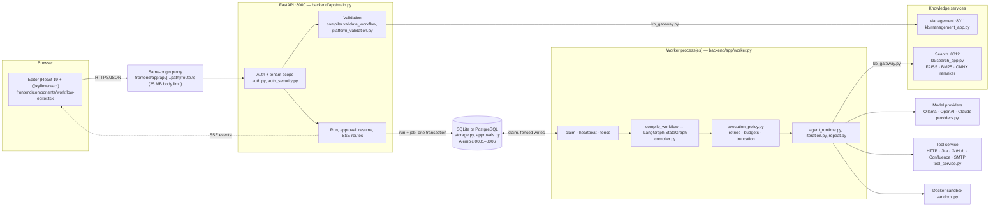

# Relay status report

Read-only audit for an outside senior engineer. Snapshot: commit `7c4aa62` (2026-11-15), branch
`codex/retrieval-answerability-safety`, audited 2026-11-16. No source code was changed.

Conventions:
- "unmeasured" means that no measurement exists in the repository.
- "not run" means that this audit did not run the check, because it takes more than 5 minutes, needs
  the network or needs API keys.
- Line counts are non-blank lines. The Python is written in a dense style (many statements per line,
  separated by `;`), so the line counts understate the amount of logic.
- Effort estimates in §8 are the auditor's judgment, not measurements.

---

## 1. Product

### What Relay does

Relay is a local, single-user platform for building AI-agent workflows on a canvas and running them on
durable workers. It is for an engineer or operator who needs a workflow with model calls, retrieval
and external writes (HTTP, Jira, email) to survive worker crashes, never send a write twice, and say
why a result is incomplete. The user drags nodes onto the canvas, connects them, clicks **Validate**
(the backend checks the graph), clicks **Run**, approves any external write in the run panel, and
watches the ordered event stream until the run finishes with an answer, a named failure or a list of
incomplete causes.

Sources: `README.md:1-14`, `frontend/components/workflow-editor.tsx`, `backend/app/main.py:111-194`.

### Node types

24 types are registered in `backend/app/registry.py:284+`. 19 are offered in the palette
(`frontend/lib/workflow.ts:412-442`). Five older types still load in saved workflows but are hidden.

| Type | What it does | Status |
|---|---|---|
| `chat_input` | Starts a run with a message from the run panel | DONE |
| `manual_input` | Starts a run on demand with a text payload | DONE |
| `agent` | Model call with a role, attached tools, specialist delegation, optional output schema | DONE |
| `retrieve` | Searches a knowledge base (similarity, keyword, hybrid, RRF); optional answerability guard | DONE |
| `query` | Retrieves evidence and generates a sourced answer | DONE |
| `condition` | Typed true/false route (text, exact decimal, membership, empty) | DONE |
| `switch` | Up to 15 ordered typed cases plus Default; checked or trusted inputs only | DONE |
| `join` | Waits for every branch of one fork (2–8 branches) | DONE |
| `calculate` | Exact arithmetic and checks on JSON fields in code, not in a model | DONE |
| `for_each` | Runs an attached body once for each list element, with per-item rows | DONE (backend and display; hidden from the palette by design) |
| `repeat` | Runs a body and an optional checker Agent until a typed stop rule is met, at most 10 times | PARTIAL: backend DONE; editor committed (`7c4aa62`), review not done; deployed scenarios PLANNED |
| `request_reader` | Prepared replies, one model read of the request, every value checked in code | PARTIAL: passes its safety gate, fails its usability gate (admits 9 of 20 valid requests, needs 18) (`README.md:276`) |
| `response` | Ends a path, validates `[S#]` citations, checks sources again | DONE |
| `tool_http` | Configured HTTP GET or POST with DNS-pinned egress | DONE (one live read-only GET to `api.github.com/zen` in the 2026-10-06 campaign) |
| `tool_email` | SMTP send | DONE (tested with fixtures; no live SMTP run found) |
| `tool_jira` | Jira operations (search used in the scenarios) | DONE (tested with fixtures over real HTTP) |
| `tool_confluence` | Confluence operations | DONE (fixtures only; no live run found) |
| `tool_github` | GitHub operations | DONE (fixtures only; no live run found) |
| `tool_python` | Python in a Docker container: no network, read-only root, 128 MB, 0.5 CPU, 32 PIDs (`backend/app/sandbox.py:43-44`) | DONE |
| `prompt` | Prompt template | Hidden (legacy) |
| `llm` | Plain model call or demo mode | Hidden (legacy) |
| `greeting_cache` | Replies to fixed messages without a model | Hidden (replaced by `request_reader`) |
| `request_router` | Classifies a request with saved rules | Hidden (replaced by `request_reader`) |
| `verify_extraction` | Checks extracted facts against the input | Hidden (replaced by `request_reader`) |

### One workflow that works end to end today

**Purchase review by amount.** Deployed scenario S17 (`scripts/check_production_scenarios.py`)
passed on 2026-11-16 at `7c4aa62`. The live variant (7b/7c, with `llama3.1` extraction) last passed
on 2026-10-06 (`evals/results/a5.1-production-2026-10-06/live-models.json`).

1. A **Chat input** receives `{"item": "laptop", "amount": 1200}`, or free text in the live variant.
2. In the live variant, an **Agent** with an output schema extracts `{"amount": …}`. Numbers are parsed as `Decimal`.
3. A **Condition** (`amount gt 1000`, Compare as number) sends the run to `true` or `false`.
4. On `true`, an **HTTP** POST to the approval desk is prepared. Its payload digest is stored, and the run pauses for approval when sign-in is on.
5. The operator approves by quoting the digest. The worker builds the payload again, checks that it is equal, marks the write, sends it, and saves the result in one transaction.
6. A **Response** returns the result. On `false`, a second Response returns the input, and nothing is sent.
7. Measured in S17: the receiver got exactly `1200`, `1000.01` and `9007199254740993`. It did not get `80` or `1000.00`. `1000.00000000000001` was refused before sending (`README.md:72`).

---

## 2. Architecture

### Components



Ports come from `scripts/dev.py:17` (3000, 8000, 8011, 8012). Ollama runs separately.

### Life of one run

| Step | What happens | Function and file |
|---|---|---|
| Request | The editor posts the workflow snapshot and the message | `POST /api/runs` → `start`, `backend/app/main.py:155-161` |
| Validate | Graph rules, bindings, typed config, model allowlist, knowledge bases, sandbox preflight | `submission_errors`, `main.py:74`; `validate_workflow`, `compiler.py:232`; `_validate_flow`, `compiler.py:110`; `binding_guarantees`, `compiler.py:38` |
| Enqueue | Insert the run row and a `queued` job row in one transaction | `Store.create_run`, `backend/app/storage.py:472` |
| Claim | Compare-and-set `UPDATE execution_jobs … WHERE run_id=? AND (queued OR lease expired)`; a new random owner id for each claim; 30 s lease | `Worker.serve`, `worker.py:276-296`; `Store.claim_next`, `storage.py:669-686` |
| Compile | Build a LangGraph `StateGraph`, restore completed nodes from checkpoints, compile it | `compile_workflow`, `compiler.py:540` (`StateGraph` at `:551`, `graph.compile()` at `:843`); called at `worker.py:229` |
| Execute | `graph.ainvoke(…, recursion_limit=150)` inside a 120 s timeout | `Worker.execute`, `worker.py:61,230,239` |
| Heartbeat | Renew the lease through the fence about every 0.2 s while the run is active | `worker.py:244-246`; `Store.heartbeat`, `storage.py:693` |
| Checkpoint | Each node's success event, checkpoint, loop item, usage rows and accounting snapshot commit in one fenced transaction | `Store.worker_event`, `storage.py:703`; `Store._fence`, `storage.py:688` |
| External write | Check the request, commit the intent marker, send, then settle the result and clear the marker in one commit | `worker.py:194-212`; `Store.mark_write`, `storage.py:814`; `Store.settle_write`, `storage.py:826` |
| Approval | Pause and release the lease; the decision quotes the digest; begin, send, complete | `approvals.pause` `:59`, `decide` `:141`, `begin` `:182`, `complete` `:196` in `backend/app/approvals.py` |
| Finish | Final status, truncation causes, token-limit record, operator metrics | `Store.finish_run`, `storage.py:751` |
| Stream | Ordered events to the browser | `GET /api/runs/{id}/events`, `main.py:194` |

Note: Relay uses the LangGraph library for graph execution only. It does not use a LangGraph
checkpointer (no `MemorySaver`, `SqliteSaver` or `PostgresSaver` in `backend/app`). Durability is
Relay's own SQL checkpointing.

### Data model

Core database: 22 tables (`backend/app/schema.py` `target_metadata`; Alembic
`backend/migrations/versions/0001`–`0006`). **No table has a foreign key.** Integrity between `runs`,
`execution_jobs`, `run_events` and the other run tables comes from application code and the fence.

| Table | Primary key | Key columns | Constraints and indexes | Added in |
|---|---|---|---|---|
| `runs` | `id` | `tenant_id`, `data` (JSON document), `status`, `accounting`, `truncated`, `truncation_source`, `duration_seconds`, `citation_counter` | IX(`tenant_id`, `created_at`, `id`), IX(`status`) | 0001; `truncation_source` 0002; `accounting` 0003 |
| `execution_jobs` | `run_id` | `status`, `owner`, `lease_until` (float epoch), `cancel_requested`, `created` | IX(`status`) | 0001 |
| `run_events` | (`run_id`, `seq`) | `tenant_id`, `timestamp`, `type`, `payload` (≤ 32 KB stored) | IX(`tenant_id`) | 0001 |
| `run_loop_items` | (`run_id`, `node_id`, `item_index`) | `entry` (JSON) | composite PK makes a repeated item an update | 0003 |
| `run_action_results` | (`run_id`, `invocation`) | `result` | one settled result for each write invocation | 0001 |
| `run_approvals` | `id` | `run_id`, `invocation`, `kind`, `payload`, `digest`, `execution` (encrypted), `status`, `expires_at`, `owns_marker` | UQ(`run_id`, `invocation`); CHECK(`kind` IN write, decision, verification) | 0001; `kind` 0004 |
| `run_token_usage` | (`run_id`, `seq`, `provider`, `model`) | prompt and completion tokens, `calls`, `partial_calls`, `unreported_calls`, `unanswered_calls` | — | 0001; status counts 0006 |
| `run_guard_decisions` | (`run_id`, `seq`) | `decision`, `reason` | IX(`decision`) | 0001 |
| `run_admission_metrics` | (`run_id`, `seq`) | `stage`, `status`, `outcome`, `replay` | — | 0005 |
| `workflows` | `id` | `tenant_id`, `document`, `updated_at` (optimistic concurrency) | IX(`tenant_id`) | 0001 |
| `credentials`, `tool_connections` | `id` | `tenant_id`, `encrypted` (Fernet) | IX(`tenant_id`) | 0001 |
| `allowed_models` | `id` | `tenant_id`, `provider`, `model`, `credential_id`, `enabled` | UQ(`tenant_id`, `provider`, `model`, `credential_id`) | 0001 |
| `auth_accounts`, `auth_sessions`, `auth_invites`, `auth_login_budgets`, `auth_bootstrap` | various | `password_hash` (PBKDF2), `token_hash`, login budget `attempts`, `blocked_until` | UQ(`email`) | 0001 |
| `approval_rate_limits`, `worker_heartbeats`, `agent_memories`, `schema_migrations` | various | — | — | 0001 |

Knowledge services have separate schemas (`backend/app/kb/management_models.py`,
`backend/app/kb/search_models.py`): `kb_management_bases`, `kb_management_originals`,
`kb_search_segments`, `kb_search_chunks`, `kb_search_postings` (PK `segment_id`, `term`, `chunk_id`)
and `kb_search_chunk_owners`.

---

## 3. Size and quality

### Lines of code (non-blank, tests excluded)

| Area | Lines | Largest files |
|---|---:|---|
| `backend/app/*.py` (45 files) | 9,024 | `compiler.py` 794, `storage.py` 786, `provenance.py` 535, `agent_runtime.py` 459, `repeat.py` 417, `providers.py` 384, `iteration.py` 355 |
| `backend/app/kb/` | 1,300 | ingestion, search, management, reranking, answerability |
| `backend/migrations/versions/` | 377 | 6 revisions |
| **Backend total** | **10,701** | |
| `frontend/components/` (hand-written) | 4,533 | `workflow-editor.tsx` 2,274, `knowledge-hub.tsx` 659 |
| `frontend/components/ui/` (60 generated shadcn files) | 6,950 | generated; not product logic |
| `frontend/lib/` | 1,986 | `request-routing.ts` 690, `workflow.ts` 635, `switch.ts` 195, `run-status.ts` 169 |
| `frontend/app/` | 2,537 | `globals.css` 2,414, proxy `route.ts` 96 |
| `scripts/` (30 Python files) + `frontend/scripts/*.mjs` | 3,280 + 254 | scenario gate, storage checks, eval runners, audit gate |
| Tests: `backend/tests/` / `frontend/tests/` | 17,801 / 4,172 | backend test code is about 1.7 times the backend product code (17,801 / 10,701) |

Repository: 198 commits from 2026-09-16 to 2026-11-15, on 44 distinct days; 1,347 tracked files;
53 review documents in `docs/reviews/`; 42 design and plan documents in `docs/superpowers/`; 166
evidence directories in `evals/results/`. There are no `TODO`, `FIXME` or `HACK` comments in
`backend/app`, `scripts`, `frontend/lib` or `frontend/components`.

### Tests

| Suite | Count | Runtime | Source |
|---|---:|---|---|
| Backend pytest | 2,143 collected in 104 files (3 need PostgreSQL) | 111.12 s for the full suite on 2026-11-16 (2,140 passed, 3 skipped) | `pytest --collect-only`; deployed-gate `backend` stage |
| Largest backend files | `test_conditions.py` 145, `test_extraction_checks.py` 109, `test_repeat.py` 82, `test_port_types.py` 74, `test_calculate.py` 71 | — | collection |
| Frontend unit (`node --test`) | 126 | 1.0 s | gate `frontend-tests` stage |
| Browser (Playwright, Chromium) | 67 | not run in this audit | `evals/results/a61-part2-2026-11-13/frontend/browser.txt` (2026-11-13) |
| Deployed-process scenarios | 28 (S01–S24 with a/b/c variants, plus M01) | 3 min 40 s with `--all`, which also runs the backend suite and frontend checks | run on 2026-11-16 |
| PostgreSQL conformance checks | 8 named checks in CI | unmeasured locally | `.github/workflows/ci.yml:126-130` |
| Mutation testing | a mutant set for each fix (for example M34–M52 for A6.1 Part 2) | — | `evals/results/*/mutants/` |

CI: 5 jobs (`backend`, `native-macos`, `frontend`, `browser-layout`, `postgres-conformance`) in
`.github/workflows/ci.yml`, plus `production-scenarios.yml`. The latest CI run (43738889884, on
`7c4aa62`) passed 5 of 5. **Job durations: not run** (they need the GitHub API, which is network).

### Lint, type check, coverage

| Check | Status |
|---|---|
| TypeScript type check (`tsc --noEmit`) | configured; passed 2026-11-16 |
| Frontend lint (`oxlint`) | configured; passed 2026-11-16 |
| Frontend formatter (`oxfmt`) | configured, not enforced in CI; existing files are not formatted |
| Python lint (ruff or flake8) | **not configured** |
| Python type check (mypy or pyright) | **not configured** |
| Coverage (Python or TypeScript) | **not configured; unmeasured** |
| Dependency audit | `pip-audit` in CI; npm gate `frontend/scripts/audit-gate.mjs` with 1 accepted residual (`braces`, expires 2026-12-04) |

---

## 4. Performance

### Measurements in the repository

| What | Result | File | Date |
|---|---|---|---|
| SQL bytes written by a loop, 100 items × 60 KB, SQLite | 642,170,768 (`bc62b0b`) → 5,492,460 (`11f8773`) → 1,639,312 (HEAD) | `evals/results/loop-storage-2026-09-29/`, `evals/results/loop-checkpoint-2026-09-30/`; re-run in this audit | 2026-09-29/30; re-run 2026-11-16 |
| The same, 1 KB items (no value dropped) | 19,470,202 → 738,803 bytes; growth per doubling ×3.67 → ×2.07 | re-run in this audit (probe scripts above) | 2026-11-16 |
| Bytes for 25/50/100 items, SQLite and PostgreSQL | 1.13 / 1.26 / 1.55 MB total | `README.md` §2.5; `scripts/check_milestone_storage.py` `storage_cost` | 2026-10 |
| Compact-marker validation memory | the earlier code allocated 89 MB for a count of 10**7; now constant | commit `c9275ba` message | 2026-09-29 |
| Retrieval latency, synthetic corpus, 45 questions | similarity 229 ms, keyword 3 ms, hybrid 233 ms, RRF 237 ms (mean) | `docs/test01-evaluation-report-2026-09-17.md:40-46` | 2026-09-17 |
| Grounding gate time for each question (llama3.1, local) | 8.364 s unguarded; 5.475 s with the guard | `evals/results/answerability-scored-generation.json`, `product-guard-fresh-2026-09-21.json` | 2026-09-21 |
| Live workflows, llama3.1 (17 shapes) | 0.3 s to 19.7 s for each workflow (chained agents 19.7 s) | `evals/results/a5.1-production-2026-10-06/live-models.json` | 2026-10-06 |
| Workflow latency, earlier campaign | 7–45 s for each workflow | `docs/production-gap-analysis.md:33` | 2026-09-16 |
| Request reader end-to-end latency, 60 requests | p50 2.10 s, p95 3.62 s; 20,787 tokens for the suite | `docs/reviews/request-reader-2026-10-14.md:15-30` | 2026-10-14 |
| Recovery time after a worker kill | 30.2–30.3 s (S15, S16, S24) = the default 30 s lease | deployed gate, 2026-11-16 | 2026-11-16 |
| Scenario wall time, other scenarios | 0.003–0.94 s each, local fixtures | same report | 2026-11-16 |
| Full backend suite | 111.12 s | same report | 2026-11-16 |

### Specific questions

| Metric | Status | Notes |
|---|---|---|
| Run throughput (runs/min) | **unmeasured** | The 4-worker check finished 50 runs, but it records no duration (`check_milestone_storage.py:109-132`) |
| Claim latency under contention | **unmeasured** | No timing in `claim_next` or its tests |
| Worker heartbeat write rate | **unmeasured** | From the code: up to about 5 `UPDATE`s per second for each active run (`worker.py:244-246`). This is a reading of the code, not a measurement |
| Compile time for large graphs | **unmeasured** | No benchmark of `compile_workflow` |
| Max graph size tested | **unmeasured** | Limit: 100 nodes, 200 edges (`backend/app/models.py:43-44`). No test that builds a graph at the limit was found. The largest tested Switch has 15 cases (`test_switch.py:111` checks that 16 are refused) |
| Max concurrent runs tested | 4 concurrent runs (4 PostgreSQL worker processes × concurrency 1, 50 queued runs) | `check_milestone_storage.py:109-132`; the default worker concurrency is 4 for each process (`worker.py:58`) |
| Cost in money | **unmeasured** | Tokens are counted (`run_token_usage`); no price table exists |
| Token streaming latency | not applicable | Providers are called with `stream: False` (`providers.py:150,258`) |

---

## 5. Reliability and security

### Failure modes handled, with tests

| Failure mode | How Relay handles it | Test or check |
|---|---|---|
| Two workers claim one run | Compare-and-set claim; only one `UPDATE` matches | `postgres-four-workers` (50 runs, 50 unique claims); `backend/tests/test_durable.py` |
| A stale worker wakes up after its lease expired | Per-claim owner id and a fence in every write transaction | `postgres-stale-lease` (5 operations refused); `test_durable.py:18`, `test_loop_storage.py:81`, `test_loop_checkpoint.py:177` |
| Worker killed in the middle of a loop | Per-item rows; resume skips committed items | `postgres-sigkill-loop`; S15 |
| Worker killed in the middle of a fork | Finished branch restored; unfinished branch runs again; write after the Join is sent once | S24; `{sqlite,postgres}-parallel-sigkill` |
| Worker killed after the receiver accepted a write | Marker without a result means uncertain; the run fails; resume returns 409 | S16; `test_platform_integration.py:48` |
| Uncertain write inside `on_error: continue` or `route` | Uncertainty stops the run anyway | S03, S04 |
| Approved payload changes before the send | The payload is built again and compared with the reviewed payload and digest | S14; `test_approvals.py` |
| Wrong digest, double approval, rejection | 409; unique (run, invocation); a rejection is terminal | S01, S02 |
| Worker restart between approvals | Nothing repeats | S05 |
| Budget reset on resume or by nesting | Accounting is saved with the checkpoint; one shared policy layer for all nodes | TA01–TA08 evidence (`evals/results/ta0*-fix-*`); `test_accounting_durability.py`; `*-accounting-*-commit` |
| Answer restored without its token count | Usage commits with the checkpoint | `{sqlite,postgres}-accounting-{before,after}-commit` |
| Silent truncation (API page cap, loop cap, agent step cap, budget) | `_truncation` port; `truncation_causes` on the run | S09; `test_tool_truncation.py`, `test_run_causes.py` |
| Binding to an output that a path cannot provide | Guaranteed-upstream rule at validation | S08, S22, S23b; `test_parallel_branches.py` (B01–B03) |
| Uncomparable or rounded numbers in a condition | Exact `Decimal`; the run fails and no branch is taken | S17–S19; `test_conditions.py` (145 tests) |
| Forged saved route on resume | The route is computed again from the input | S21a |
| Case named `approved` used as permission | A case name grants nothing | S21c |
| Sibling branch failure | The other branches are cancelled; nothing after the Join is sent | S23a |
| Loop results larger than a row | 1 MB retained-value cap; 2,000-character previews; 32 KB events | `test_loop_storage.py`, `test_loop_event_bounds.py` |
| Compact marker tampered with or partial | Exact row set and SHA-256 check; the loop is marked unavailable | `test_loop_checkpoint.py` |
| Schema downgrade | Loss is visible and fails closed, not silent | `populated-downgrade` (CI) |
| Two tabs edit one workflow | `updated_at` check; 409 | S13 |
| Invented citations | `[S#]` validated against a run-wide registry | `test_response_source_boundary.py` (52 tests) |
| Source removed before publication | Sources are checked again at the Response; the run fails closed | `docs/reviews/r01-i01-recheck-2026-10-31.md` |
| Embedding model changed under an index | Digest pinned for each index; search refuses | `test_kb_*.py` |
| Transient read failure | Retry policy for reads only | S06, S07 |
| onnxruntime telemetry thread aborts at exit (macOS) | Disabled before import | CI `native-macos`, `test_onnxruntime_telemetry.py` |

### Failure modes not handled

| Gap | Source |
|---|---|
| An uncertain write needs a person to reconcile it, but there is no reconcile endpoint or screen. The run only fails | `backend/app/main.py` (no route); `README.md` §2.3 |
| Relay sends no idempotency key to remote systems | `backend/app/tool_service.py` (none found) |
| A read in flight at a crash is retried once and charged again | `README.md` §2.2 |
| A model response lost before its commit is paid for again and is not counted | `README.md` §2.6 |
| The token ceiling is an admission limit: the last call (one call for each branch in a fork) can go over; calls with no reported usage add nothing | `README.md` §2.6, §7 |
| Lease expiry uses each worker's wall clock, not the database clock; clock skew between hosts is not handled | `storage.py:670,690` (auditor reading) |
| Runs have a fixed 120 s timeout that cannot be configured | `worker.py:19,239` |
| The queue is global FIFO; one tenant can starve the others | `README.md` §6 (B2), §7 |
| No run deletion and no retention; `run_loop_items` and `run_events` grow without limit | `main.py` has no `DELETE` route; `docs/reviews/loop-storage-audit-2026-09-29.md` (scope limits) |
| No foreign keys; orphan rows are possible if code paths diverge | `backend/app/schema.py` metadata (auditor reading) |
| No writes or approvals inside parallel branches (refused at validation) | `README.md` §6 (A5.3b) |
| Downgrades lose loop items and accounting (documented, fail closed) | `README.md` §2.12 |
| No token streaming to the user | `providers.py:150,258` |
| Prompt injection through tool or retrieval text into an agent is limited only by write consent, approvals and citation checks; there is no input sanitizer or detector | auditor reading of `agent_runtime.py` |
| Five unanswerable questions in the grounding gate still get unsupported answers | `docs/evaluations/2026-09-21-product-guard.md` |

### Security controls in place

| Control | Where |
|---|---|
| PBKDF2-SHA256, 600,000 iterations | `backend/app/auth.py:21,78-79` |
| Login budgets for each account and IP, checked before hashing, stored in the database | `backend/app/auth_security.py`; `auth_login_budgets` |
| Session cookie `HttpOnly`, `SameSite=Strict`, `Secure` when the request is HTTPS | `auth.py:164-166` |
| CORS limited to `127.0.0.1:3000` and `localhost:3000` | `main.py:66` |
| Closed registration by default; single-use expiring invites | S11; `auth_invites` |
| Tenant scope on every query | S12 |
| SSRF: global addresses only, DNS pinned to the checked IP, SNI kept, no redirects, proxy env ignored | `tool_service.py`; S10 |
| Fernet encryption for credentials, connections and approval plans | `storage.py`, `approvals.py` |
| Model allowlist for each workspace | `allowed_models`; `Store.authorize_run_model` |
| Docker sandbox with no network and resource limits | `sandbox.py:43-44` |
| Write consent on each node plus approval by default when signed in | `README.md` §3 |
| Fail-closed npm audit gate; `pip-audit` | `frontend/scripts/audit-gate.mjs`; CI |

### Known security gaps

- The frontend proxy does not forward the client IP, so all users behind it share one IP budget (`README.md:198`).
- One person for each tenant; no roles (`README.md:272`).
- Loopback-only deployment. No TLS, managed secrets or backups (`README.md:273`). The Fernet key is a local file next to the database (`main.py:54`, `local_key`).
- No penetration test. The controls are regression checks (`README.md:198`).
- One accepted npm residual (`braces` through `vinext`, expires 2026-12-04).

---

## 6. Evaluation

### Datasets

| Dataset | Size | Labels made by | Used for tuning? |
|---|---|---|---|
| `evals/questions.json` + `evals/corpus/` (20 synthetic handbook documents) | 50 questions: 20 verbatim, 20 paraphrase, 5 reasoning, 5 unanswerable | Synthetic, written with the corpus | Yes, for the early retrieval work (2026-09-16/17) |
| `evals/test01-regressions.json` | 7 | Regression cases from the test01 report | Regression only |
| `evals/real/questions.json` | 38: verbatim and paraphrase over IRS Pub 463, NIST SP 800-63B-4, 29 CFR 1910.178, 49 CFR 395 | Original real-document set | Yes: chunking, reranking and threshold work (`docs/f11-retrieval-calibration-report.md`) |
| `evals/real/questions-expanded.json` | 53: the 38 above + 15 new unanswerable (8 `calibration`, 7 `holdout`); 33 answerable, 20 unanswerable | Assistant annotations; no independent human review (`docs/answerability-safety-report.md`) | The gate thresholds were fixed after a run on this same set (`docs/evaluations/2026-09-21-grounding-fresh-result.md`). The reader threshold (0) was predeclared. The 7 holdout questions are all unanswerable |
| `evals/claim-calibration-labelled.json` | 24 claim cases | "Codex assistant", `independent_human_review: false`, labels frozen before the judge | Used to reject the NLI and llama3.1 claim judges |
| `evals/request-admission/questions.json` + `expectations.json` | 60 requests (20 proceed, 20 clarify, 10 out of scope, 10 prepared reply); 36 development, 24 held out | "Human-authored expected admission", frozen before changes, labelled before measurement | Development split used; held-out split reported separately (3 of 8 held-out valid requests admitted) |

### Models and providers run end to end

| Model or provider | Use | Last end-to-end run |
|---|---|---|
| Ollama `llama3.1:latest` | Agents, grounding gate, live campaign, request reader | Live campaign 2026-10-06; grounding gate 2026-09-21 |
| Ollama `embeddinggemma:latest` | Embeddings for the knowledge services | 2026-09-21 (grounding gate) |
| `tinyroberta-squad2` ONNX | Answerability reader | 2026-09-21 |
| `ms-marco-MiniLM-L-6-v2` ONNX | Cross-encoder reranker | 2026-09-21 |
| `cross-encoder/nli-MiniLM2-L6-H768` ONNX | NLI verifier experiment (rejected) | `docs/nli-calibration.md` |
| Ollama `gemma3`, `llama3.2:3b`, `qwen2.5:0.5b` | Named in some evidence files; no full gate run on them found | unmeasured |
| OpenAI, Claude | Adapters tested only on recorded response shapes and fixtures (`gpt-fixture`, `claude-fixture`) | **never run live** in the repository evidence |
| Docker sandbox | `tool_python` | live campaign 2026-10-06 |

Not run in this audit: the grounding gate (needs Ollama and local weights, more than 5 minutes) and
the live campaign (`--live-models`).

---

## 7. Deployment and demo

### How to run it today

From `README.md:283-302`:

```bash
python3 -m venv .venv && .venv/bin/pip install -r backend/requirements.txt
(cd frontend && npm ci)
ollama pull llama3.1 && ollama pull embeddinggemma
python3 scripts/dev.py
```

| Process | Port | Started by |
|---|---|---|
| Editor (vinext) | 3000 | `scripts/dev.py` |
| API (uvicorn, FastAPI) | 8000 | `scripts/dev.py:47` |
| Knowledge management service | 8011 | `scripts/dev.py:32-43` |
| Knowledge search service | 8012 | `scripts/dev.py:32-43` |
| Worker (`python -m backend.app.worker`; `dev.py` sets `RELAY_EMBEDDED_WORKER=false`, otherwise the API runs an embedded worker) | — | `scripts/dev.py:23,57`; `backend/app/main.py:55-58` |
| Ollama | 11434 | the user |
| PostgreSQL (optional) | 55432 | `compose.yaml` (the only container in it) |

A new user needs Python 3.12+, Node.js 22.13+, Ollama with two models, Docker (for `tool_python`),
and Poppler and Tesseract for scanned PDFs. SQLite is the default.

### Public deployment and demo material

| Item | Status |
|---|---|
| Public deployment | None. No `Dockerfile` for the app; `compose.yaml` runs only PostgreSQL; the README says loopback use only |
| Demo video or GIF | None in the repository |
| Screenshots | 10 PNG files tracked under `evals/results/` (for example `evals/results/a61-part2-2026-11-13/screens/canvas.png`). None are in the README |
| Hosted docs | None. Docs are Markdown in `docs/` on GitHub; the repository is public |

### What blocks a public demo

1. No container image for the API, worker, knowledge services and editor.
2. Ollama on the host is required; no hosted model has been run end to end (§6).
3. Loopback-only design: CORS allows only `localhost:3000`; no TLS; the proxy does not forward the client IP; one user for each tenant.
4. Write tools need real credentials. A safe public demo needs fixture receivers, like the scenario gate uses.
5. The 120 s run timeout, and the 0.3–19.7 s latency for each workflow on a local 8B model.
6. No retention: a public instance would grow `run_events` without limit.

---

## 8. Scope

Effort: S < 1 day, M 1–5 days, L > 5 days (auditor estimates). GitHub issues: **not run** (needs network).

| Item | Status | Effort | Depends on | Risk if left unfinished |
|---|---|---|---|---|
| A6.1 Part 2: Repeat editor, implementation review | PARTIAL | S | review findings | The Repeat stays unreviewed in the editor |
| A6.1 Part 3: Repeat deployed scenarios | PLANNED | M | Part 2 | The loop has no deployed-process crash evidence; it is weaker than fork/Join |
| A6.2: subgraphs | PLANNED | L | published workflow versions | Large workflows cannot be reused |
| A5.3b: writes and approvals inside branches | PLANNED | L | a new branch runtime | Parallel work cannot act |
| Strict token cap (reserve, then settle) | PLANNED | M | provider `max_tokens` on every call | A run can end above its limit |
| Request reader usability (9 of 20 → 18 of 20) | PARTIAL | M–L | a new frozen test set | The node is safe but rarely admits requests |
| Elasticsearch and Pinecone, live | PARTIAL | M | service accounts (network) | The README stack lists backends that were tested only with fakes |
| OpenAI and Claude, live | PARTIAL | S–M | API keys | Quality claims cover only one 8B local model |
| Live-model campaign re-run (17 shapes) | PARTIAL | S | Ollama, more than 5 min | The last run (2026-10-06) is before Switch, fork/Join and Repeat |
| Held-out grounding evaluation | not started | M | human labels | The grounding numbers are calibration-set numbers |
| B2: Redis (per-tenant budgets, rate limits, fair queue) | PLANNED | L | — | Starvation; rate state lives in one process |
| B3: object storage for documents | PLANNED | M | B2 | Documents are on the local disk |
| B4: organizations, roles, resource grants | PLANNED | L | B2 | Single user only |
| B5: SSO, SCIM, audit log | PLANNED | L | B4 | No enterprise identity |
| C1: data-source SPI and conformance suite | PLANNED | L | B1 | — |
| D: Text-to-SQL over a semantic layer | PLANNED | L | C1 | — |
| E: GraphRAG against the same gate | PLANNED | L | a held-out gate | — |
| F: OpenTelemetry, eval cross-checks | PLANNED | M | — | No traces; only journal logs and SQL metrics |
| TLS, managed secrets, backups | PLANNED | M | a deployment target | Not deployable beyond loopback |
| Load testing | PLANNED | M | a deployment target | Throughput and claim latency stay unmeasured |
| Reconcile endpoint or screen for uncertain writes | not in the roadmap (auditor) | M | — | A person must fix the database by hand |
| Run deletion and retention | not in the roadmap (auditor) | M | — | Unbounded growth |
| Configurable run timeout | not in the roadmap (auditor) | S | — | Long agent runs fail at 120 s |
| Token streaming | not in the roadmap (auditor) | M | providers | Slow perceived latency |
| Container image and public demo | not in the roadmap (auditor) | M | the items above | No reviewer can try it without a local setup |

Sources: `README.md` §6–§7; `docs/production-gap-analysis.md`; `docs/reviews/`.

---

## 9. Comparison

Based only on this repository and on facts the auditor is sure of. **[uncertain]** marks points to
check against current vendor documentation before you repeat them.

| Tool | Relay has, the tool does not | The tool has, Relay does not |
|---|---|---|
| **Temporal** | A no-code canvas; LLM, agent and retrieval nodes; token accounting with an admission limit; citation and answerability checks; compile-time binding checks for each path | Event-sourced history with deterministic replay; SDKs in several languages; signals, queries, timers and schedules; workflow versioning; proven horizontal scale; a hosted service. Temporal retries activities by default, so the user must make them idempotent. Relay refuses to retry writes instead |
| **n8n** | Fenced leases and per-claim fencing; the three-state write protocol (marked, settled, uncertain); digest-bound approvals; exact-decimal typed conditions; refusal of unsafe bindings before a run | Hundreds of integrations; triggers (webhook, cron); a large community; queue mode with Redis workers **[uncertain on details]**; production deployments; multi-user options |
| **Dify** | Crash-resume with per-node SQL checkpoints and fencing **[uncertain whether Dify resumes a run in the middle after a worker crash]**; the write-uncertainty protocol; a predeclared grounding gate | Many model providers; hosted cloud; team workspaces; a plugin system; published app APIs; observability integrations **[uncertain on the exact list]** |
| **Flowise** | The same durability and write-safety points as above | Visual LangChain and LlamaIndex building blocks; many vector stores and integrations; a hosted option **[uncertain]** |
| **LangGraph Platform** (the product; Relay uses the open-source library) | A no-code editor; compile-time path checks; the write-uncertainty protocol; digest-bound approvals; token admission limits that survive resume | A durable LangGraph checkpointer and a task queue for scale; streaming; threads and a memory store; LangGraph Studio for debugging; interrupts for human-in-the-loop; cron. The name and packaging of the platform changed during 2025 **[uncertain]** |
| **Prefect** | LLM, agent and RAG nodes; a canvas; write-uncertainty handling | Python-first data orchestration; scheduling; deployments, work pools and a hosted UI; caching and retries for tasks; a mature ecosystem |

Summary: Relay's difference is correctness under failure for workflows that call models and send
writes, with evidence (deployed scenarios, PostgreSQL checks, mutation testing). Each of the tools
above is ahead on integrations, scale, deployment and number of users.

---

## 10. Honest summary

### The 3 strongest technical points

1. **Failure semantics with evidence.** Compare-and-set claims, a fence for each claim, write intent before the send, and usage saved with each checkpoint. These are checked by SIGKILL and SIGSTOP tests on SQLite and PostgreSQL, and by 28 deployed scenarios (`scripts/check_production_scenarios.py`, `scripts/check_milestone_storage.py`).
2. **Verification discipline.** Tests are written first and shown to fail on a clean `git archive`; mutation testing for each fix; five hash seeds; 53 independent review documents, including the reviews that found defects (`docs/reviews/`, `evals/results/*/mutants/`).
3. **Honest incomplete results.** Typed truncation causes, exact decimals, failure instead of guessing, a predeclared answerability threshold, and rejected experiments kept as evidence (`README.md` §2.7, §2.9, §4).

### The 3 weakest points an interviewer would find

1. **No scale or performance numbers.** Throughput, claim latency, heartbeat write rate, compile time and the 100-node limit are all unmeasured. The highest tested concurrency is 4 runs. The heartbeat writes about every 0.2 s for each run, from the code.
2. **Evaluation depth.** One 8B local model, one 53-question set with assistant labels, and thresholds fixed after a run on the same set. No hosted model has run. The OpenAI and Claude adapters and the Elasticsearch and Pinecone backends were never exercised live.
3. **Not deployable or demoable.** No container image, loopback only, one user for each tenant, a fixed 120 s run timeout, no retention, no foreign keys, no reconcile path for uncertain writes, and no Python lint, type check or coverage.

### Claims in the README or docs that go beyond the code

| Claim | Location | What the evidence shows |
|---|---|---|
| "a 53-question grounding gate with thresholds fixed before measurement" and "Thresholds were committed (`33f7da4`) **before** the evaluation that now passes them" | `README.md:13,204` | True for the final run, but the thresholds were chosen after an earlier run of the same configuration on the same questions. The doc itself calls it "a repeatability check, not an independent held-out safety evaluation" (`docs/evaluations/2026-09-21-grounding-fresh-result.md`) |
| "17 live-model workflows" in the Verification row | `README.md:13`, §5 | The last live run was 2026-10-06 at `64e03f7`, before Switch, fork/Join and Repeat. It has not been run since |
| Stack: "Ollama, OpenAI, Claude" and "FAISS, Elasticsearch, Pinecone" | `README.md:12` | OpenAI and Claude never ran live; Elasticsearch and Pinecone are tested only with fakes (`backend/tests/test_kb_search.py:121`) |
| "60 Chromium tests" | `README.md` §5 table | The header says 67, and the last run had 67. The §5 row is out of date |
| "A read-only copy of a real workspace database was upgraded with all 27 table row counts preserved" | `README.md` §2.12 | Passed on 2026-10-05 at revision `0003` (`evals/results/milestone-2026-10/storage-final/report.json`). The 2026-11-11 run of the same check failed because the isolation copy had no workspace database (`evals/results/a61-part1-2026-11-11/storage-all.json`). Not checked at `0006` |
| "never send an external write twice" (tagline) | `README.md:3` | True for the tested paths (S03, S04, S16, S24). Relay prevents its own second send; it cannot make a remote system idempotent. The body text bounds this correctly ("no duplicate writes", §2.2) |
| "27 deployed-process production scenarios" | `README.md:13` | The gate has 27 S-scenarios plus M01 (28 rows). The difference is small |

---

Changelog: 2026-11-16, created at commit `7c4aa62` (2026-11-15). The deployed gate (33 of 33 rows),
the storage probes on `bc62b0b`, `11f8773` and HEAD, and backend test collection were run for this
report. CI job durations, GitHub issues, the browser suite, the PostgreSQL checks, the grounding gate
and the live-model campaign were not run.
